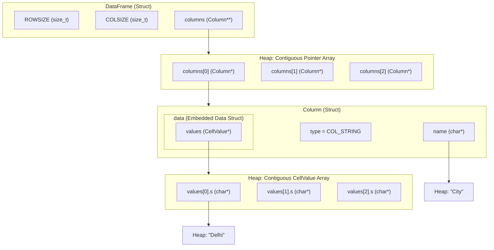

# CSV Parser Memory Layout

## Visual Architecture

## Memory Ownership Summary

| Struct / Field | Allocation Type | Contiguous? |
| :--- | :--- | :--- |
| `DataFrame->columns` | `malloc(COLSIZE * sizeof(Column*))` | Yes (array of pointers) |
| `Column` | `malloc(sizeof(Column))` per column | No (individual heap blocks) |
| `Column->data` | Embedded inside `Column` | Yes (part of `Column` block) |
| `Column->data.values` | `malloc(ROWSIZE * sizeof(CellValue))` | Yes (contiguous cell slots) |
